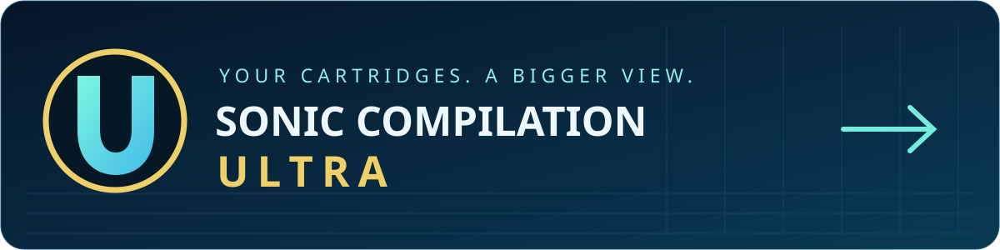
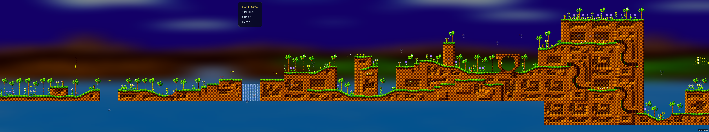
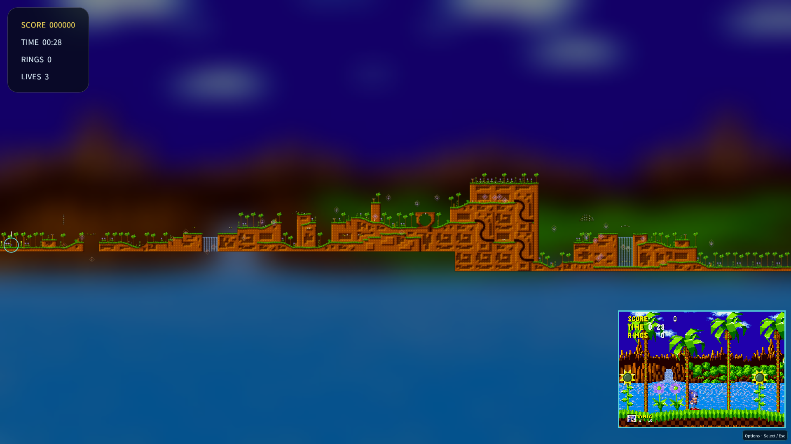
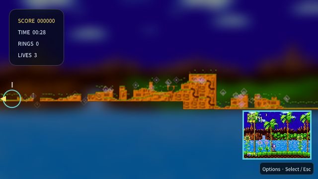
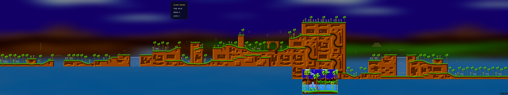
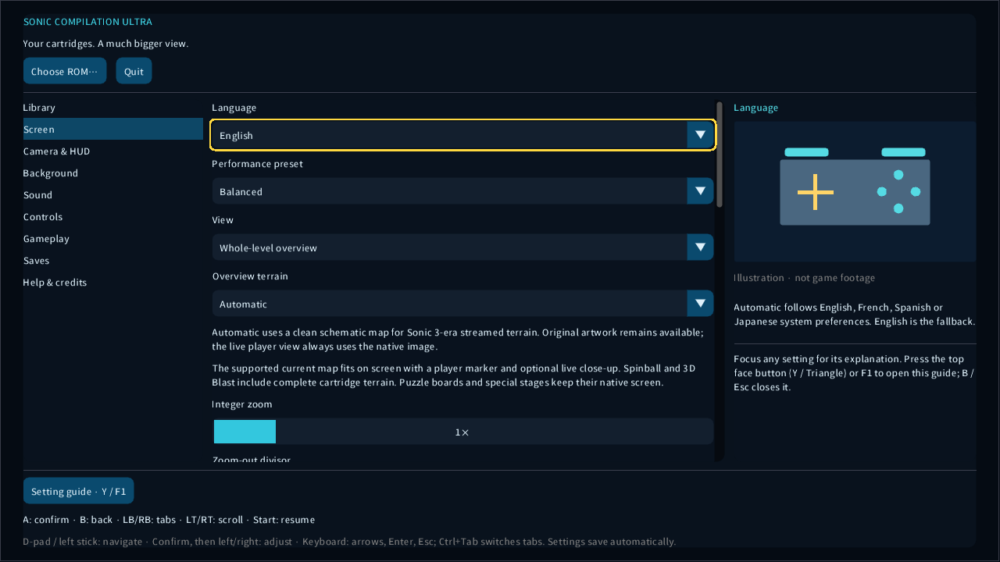
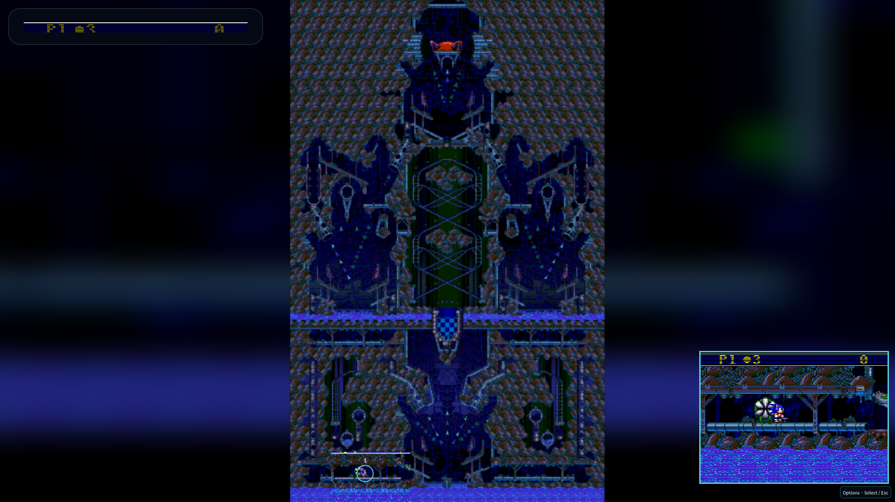
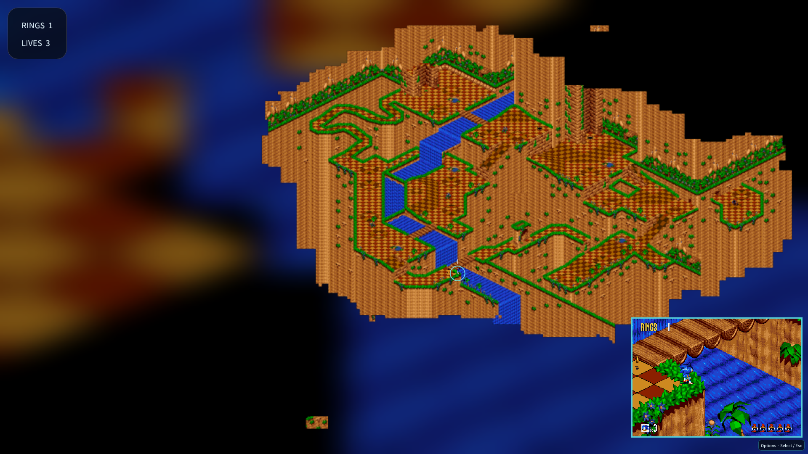
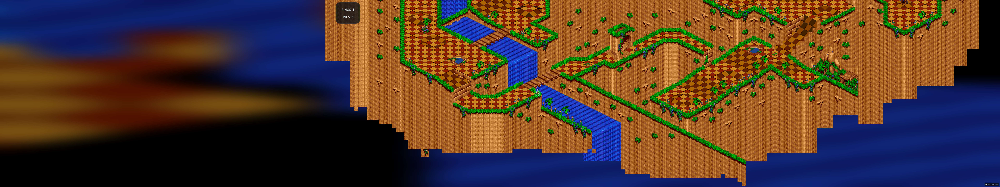
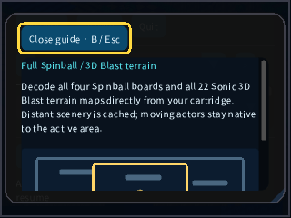

  <a href="https://github.com/vhaloo/SonicCompilationUltra/releases/latest">Download</a> ·
  <a href="docs/QUICK_START.md">First steps</a> ·
  <a href="docs/ROMS.md">ROM guide</a> ·
  <a href="docs/FEATURES.md">All options</a>

**Play your own Mega Drive / Genesis Sonic cartridges with an adaptable PC interface, huge views and backgrounds that look good at any aspect ratio.** No ROMs are included.

Windows and Linux · **macOS: experimental** · English, French, Spanish and Japanese · Keyboard and gamepads

**Mac builds are experimental:** Intel and Apple Silicon packages pass automated build/runtime checks, but have not been tried on a physical Mac. Display, audio and real-controller compatibility still need Mac testing. Linux packages are checked on Ubuntu 22.04 in CI, including the portable launcher.

## Start playing

1. **[Download your platform’s package](https://github.com/vhaloo/SonicCompilationUltra/releases/latest)** and extract it completely. On Windows, open `SonicCompilationUltra.exe`; on macOS, open the app; on Linux, run the included launcher.
2. Choose **Choose ROM…** using a mouse or gamepad or drop your own `.bin`, `.md`, `.gen`, `.smd` or `.zip` into the window. The app checks the file’s contents. [Which edition do I need?](docs/ROMS.md)
3. Choose **Play**. Use **Enter / gamepad Start** on the original title screen. Move with the arrows or left stick; jump with **Z, X, C / gamepad A, X, B**.
4. Open the fullscreen options whenever you like: **Esc, F10 or gamepad Select / View**. Use **A / bottom face button** to confirm, **B / right face button** to go back, **LB/RB** to switch sections and **LT/RT** to scroll. Gameplay pauses in the menu.

No installer, administrator access or game-data upload is required. English is the fallback language; a supported machine language is selected automatically. You can change it under **Screen → Language**.

## A small screen or three huge ones

**New installations start in borderless fullscreen with a Whole-level overview.** The current supported map fits on screen, with a player marker and live close-up. This includes **all four Spinball boards and all 22 Sonic 3D Blast terrain maps**, keeping 3D Blast’s isometric perspective. Sonic 3-era scenes can use a clean terrain diagram. Fullscreen menus keep their content readable in the centre, even across three monitors.

**Pixel world at 1× with divisor 1×** shows one game pixel per physical display pixel. Zoom farther out to **1/8**, restore exact 1:1 with one button, or choose a Panorama height from **224 to 4096 world pixels**. Reduced-map smoothing limits shimmer; magnified pixels stay crisp. **Balanced** and **Lightweight** reduce overview work while preserving your chosen view. Resize freely, choose a fullscreen display or span all displays.

Choose a familiar **Panorama**, a very wide **Pixel world**, a **Whole-level overview**, or the **Original game framing**. Follow the player, freeze the view or explore with a free camera. Keep the HUD on the centre monitor, attach it to the player, move it to an edge or hide it.

*48:9 · 7680 × 1440 · actual game rendering at pixel 1:1. Open the image to inspect the full resolution.*

<table><tr>
<td width="66%"> <em>16:9 · 1920 × 1080 · stage overview</em></td>
<td width="34%"> <em>Small window · 640 × 360</em></td>
</tr></table>

48:9 whole-stage view

**Every setting has an illustrated explanation in English, French, Spanish and Japanese.** Focus an option with the gamepad or mouse: the guide appears beside it on larger screens. **Y / Triangle (top face button), or F1**, opens the scrollable explanation on any screen; **B / Esc** closes it.

<table><tr>
<td width="50%"> <em>Spinball · full board with authentic live close-up</em></td>
<td width="50%"> <em>3D Blast · full isometric terrain</em></td>
</tr></table>

3D Blast in 48:9 and the setting guide on a tiny screen

## The collection

| Platform games and lock-ons | More cartridge games |
|---|---|
| Sonic the Hedgehog, Sonic 2, Sonic 3 | Dr. Robotnik’s Mean Bean Machine |
| Sonic & Knuckles, Sonic 3 & Knuckles | Sonic Spinball, Sonic 3D Blast |
| Knuckles in Sonic 2, Blue Sphere | Sonic Compilation / Sonic Classics |

Import separate cartridges and the app can assemble the standard lock-ons locally. **Attach Sonic & Knuckles** also exposes its original lock-on behaviour with other imported cartridges. Knuckles in Sonic 2 requires the cartridge’s UPMEM chip or the supported combined dump. [Details](docs/ROMS.md#lock-on).

The main platform games, Spinball, 3D Blast and the Sonic 1/2 stages inside Sonic Classics have an experimental world renderer. Puzzle games, special stages and native competition retain their original complete screen, with correct pixel scaling. Distant terrain is visible; **moving actors still follow the cartridge’s native activation range**. The cartridge engine is **Genesis Plus GX**; this project is an enhanced collection, not a new decompilation of every game.

## Make it yours

**A small corner badge keeps the menu shortcuts handy.** Open **Camera & HUD** to choose its corner, content, size, opacity, spacing or auto-hide timer. Notifications and active rewind have their own controls; performance counters stay available even with the badge hidden. Click the badge, or use **Select / View, Esc or F10**, to open options at any time. The native game screen uses the full available height.

Six backgrounds include a softly blurred landscape stretched from the game’s own scenery. Blur and brightness are adjustable; characters and terrain stay sharp. You also get a locator, minimap, scanlines, a camera-frame guide, optional **Sonic 1 spin dash**, damage/air assistance, rewind, nine save slots per game, automatic resume, controller dead zones, three gameplay button layouts, button-label hints, large text, high contrast, safe confirmations and rendering presets. The ROM browser includes an on-screen path keyboard.

**See enemies and bosses before they pop in.** Expanded platform stages preview placed enemies, bosses and supported scripted spawns. Amber marks enemies, red marks bosses and purple marks scripted objects and projectiles. Variable attacks show their **origin**; fixed positions can show transparent cartridge sprites. Adjust the independent toggles, opacity, labels, tint and overview framing under **Camera & HUD**, entirely with a gamepad. [How previews work and their limits](docs/ENEMY_PREVIEWS.md).

**Hold the right shoulder** for quick zoom, overview, freeze/follow, player focus or screenshots. **+ / −** changes zoom, **F** freezes the camera, **R** restores following, **Shift + F1…F9** saves and **F1…F9** loads. The menu’s **Controls** page has the complete guide.

**Hold L2 / Xbox LT, or Backspace, to rewind at normal speed with the sound playing backwards.** Release to continue from that moment. Rewind is enabled on new installs; existing preferences are kept. Gameplay offers reversed sound and 24 / 96 / 192 MB history budgets, while Controls lets you change the gamepad button. History stays in memory and starts building as you play.

## Before you download

This is a **preview release**. Original framing provides the native cartridge display; expanded views can expose art-bank and scrolling limitations, especially during Sonic 3 transitions. Full-game completion and every GPU/controller combination are not certified. See the [tested coverage](docs/TEST_REPORT.md) and [known limits](docs/FEATURES.md#known-limits).

Use game data you are entitled to use. The executable supplies no ROM, music, BIOS or extracted game-art pack. Gameplay screenshots document the app; game graphics and names remain the property of their rights holders. This independent, noncommercial fan project is not affiliated with SEGA. [Licences and distribution boundaries](docs/LEGAL.md).

For contributors: [build from source](docs/BUILD.md), [Sonic 1 research catalogue](docs/RESEARCH.md), [third-party notices](THIRD_PARTY_NOTICES.md).
