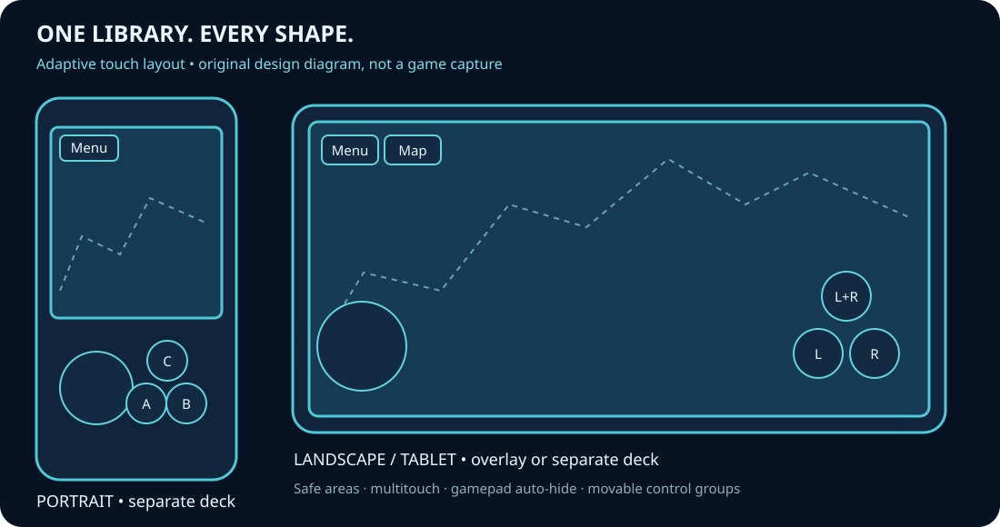

# Android phones and tablets

Use **Android-Mobile-ROM-free.apk** from the [0.8 preview release](https://github.com/vhaloo/SonicCompilationUltra/releases/tag/mobile-xr-preview-0.8.0). This is a regular Android application, separate from the **Quest** APK. It does not need a headset, OpenXR, a network connection or storage permission. Android 7.0 / API 24 or newer and OpenGL ES 2.0 are required. The universal APK contains ARM64, ARMv7 and x86-64 libraries.

1. Download the APK to the phone or tablet, open it, and allow installation from that source if Android asks. Install only a build you trust.
2. Open **Sonic Compilation Ultra**. Tap **Choose ROM** to select your own cartridge file or ZIP using Android's document picker. Public builds include no commercial games or assets.
3. Tap **Play**. **Menu** stays in a corner; gameplay pauses while options are open. The bottom options dock offers **Back**, previous/next section, and **Up/Down** (hold to scroll). All normal settings remain available by touch or gamepad.

The owner's private APK is different: its local cartridge library is packaged in `assets/scu/ROMs`, with relative library paths in `assets/scu/UserData/library.tsv`. On first launch the app copies it to its private storage automatically. No manual file move or separate ROM import is needed. Existing saves, cartridges and preferences are preserved on updates. Private packages are never GitHub release assets.



## Display and controls

- **Auto layout:** portrait uses a separate control deck; landscape puts the controls over the game. Select either layout explicitly in **Phone / tablet**. Tablets, foldables, external displays and split windows use their actual available size and density. Camera cutouts, system bars and system-gesture areas are accounted for.
- **Controls:** joystick moves; A/B/C retain the original console actions; Start starts/pauses. In Spinball the buttons read **L**, **R**, **L+R** for the flippers, and the joystick nudges. Hold **<<** to rewind, including reversed audio when enabled. A connected gamepad uses the normal bindings; Spinball uses LT/RT and LB for rewind.
- **Adjust:** control size, opacity, dead zone, safe margin, left/right arrangement and independent joystick/button offsets. Auto-hide with an attached gamepad, always show, or gamepad-only. The Menu, Map and zoom buttons remain reachable. Rotation, app switching, resizing and controller visibility changes clear finger captures.
- **Views:** whole-stage overview by default, native view, panorama, literal pixel scale, player follow and fixed camera. **Map** switches between overview and pixel view; **+ / -** change zoom. The same terrain and spawn-preview capabilities and limitations as desktop apply.
- **Power:** 60 fps presentation by default, with 30/90/120/display-maximum options. The console keeps its original simulation speed. Panorama resolution budgets of 1 / 2.5 / 8 megapixels reduce memory and CPU work; literal Pixel view retains output resolution. Large render targets are also clamped to the GPU's reported limit. The system controls actual display refresh and may override orientation preferences in multiwindow or on large screens.
- **Languages:** automatic English/French/Spanish/Japanese according to the device, with a manual override. Default fallback is English.

This is an **experimental development preview**. The 0.8 work uses compilation, Android lint, APK/dependency/signature/alignment audits and pure CPU layout/input checks. No game, Android application, phone, tablet, emulator or Quest session was executed for this release. Visual quality, hardware input, refresh, thermal behavior, fold hinges and every vendor-specific window mode still need device testing. There is no claim of flawless behavior on every Android device. A folding screen's occluding hinge is not yet exposed as a separate exclusion region; use split-window mode or reposition controls if needed.

## Build

Run `python tools/prepare_quest.py` to prepare the pinned SDL sources (shared by both Android editions), then:

```sh
cd android
./gradlew :mobile:assembleRelease :mobile:lintRelease
```

NDK 29.0.14206865, CMake 3.31.6, SDK/build-tools 36, AGP 9.4.0 and Gradle 9.8.2 are pinned. CMake uses `SCU_QUEST_BUILD=OFF` for `:mobile`; `:app` remains the Quest target. `scuMobilePrivateAssets` and `scuPrivateAssets` are deliberately separate optional local paths. No personal data, keys or developer paths belong in Git. Public CI uses a debug certificate only for preview APKs; locally delivered personal builds use the retained private signing key. Installations with different signing certificates cannot update each other without uninstalling, which removes local app data.

Implementation references: [Android adaptive orientation/resizing](https://developer.android.com/develop/adaptive-apps/guides/app-orientation-aspect-ratio-resizability), [system/cutout/gesture insets](https://developer.android.com/develop/ui/views/layout/edge-to-edge), [SDL drawable size](https://wiki.libsdl.org/SDL2/SDL_GetRendererOutputSize). These document the platform behavior; they do not constitute device qualification.

The phone module generates an adapted copy of SDL Java glue at build time: explicit non-exported USB registration on API 33+, a package-scoped USB permission intent, API-26 annotations on runtime-gated handler classes, and the Activity-owned modern Back callback. The pinned SDL archive is unchanged. Lint exceptions are scoped to unused upstream BLE/audio capture paths and the guarded legacy Back/receiver implementations; application code stays checked. The normal VIBRATE permission supports SDL gamepad haptics and requires no permission prompt.
