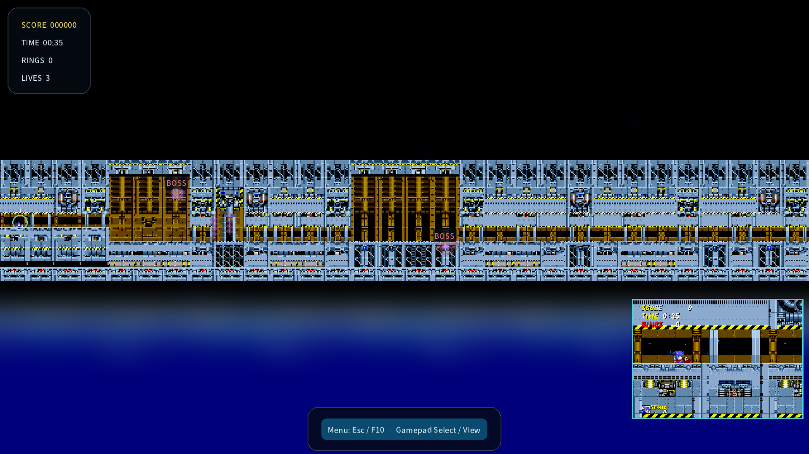
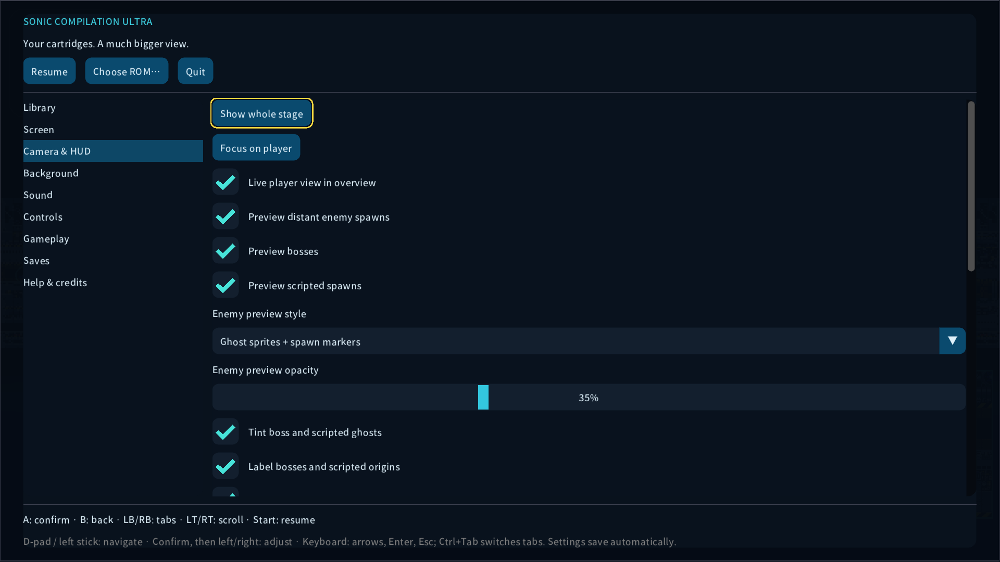

# See spawns before they surprise you

Expanded platform views show spawn previews before the original game activates objects. The setting starts enabled at **35% opacity**: amber marks enemies, red marks bosses and purple marks scripted objects and projectiles. **ORIGIN · position varies** identifies a source or encounter trigger whose eventual attack position depends on runtime conditions.

Open **Esc / F10 / gamepad Select or View → Camera & HUD**. Adjust style and opacity, switch bosses and scripted previews independently, and choose ghost tint, labels and overview framing that includes distant spawns. Every control works with the D-pad or stick, confirm/back and trigger scrolling. Boss markers are larger. Labels favour bosses and avoid overlapping one another.

| Style | What you see |
|---|---|
| Ghost sprites + spawn markers | Transparent cartridge sprites and readable position markers |
| Ghost sprites | Sprites, with a marker when the image cannot be shown |
| Spawn markers | Colour-coded markers that remain visible in a whole-stage overview |

The preview disappears when its native sprite is visible. Remembered defeated objects and sources hide their future previews. Sonic 1/2 boss defeat is observed; Death Egg's successive fights are distinguished. Respawning objects can return. Waiting objects with an empty native sprite retain their warning.

Fixed points come from cartridge placements, supported creation tables and event instructions. Parent-relative points follow their live source; nested descriptions resolve back to their placed source. Variable attacks show an origin marker, without inventing a ghost or trajectory. Sandopolis' delayed miniboss uses its authored encounter trigger when its position depends on the camera. This does not start AI early, run future combat, allocate native objects, alter collisions or write cartridge RAM. Initial art and the loaded palette can differ from later animation or a boss palette.

The supported ROM editions of **Sonic 1, Sonic 2, Sonic 3, Sonic & Knuckles, Sonic 3 & Knuckles and Knuckles in Sonic 2** have previews in expanded ordinary platform stages. Original framing, special projections, native competition, Mean Bean, Spinball, 3D Blast and the original Compilation cartridge retain their native display.

The parser covers placed bosses, recognized Sonic 1/2 event bosses, bounded Sonic 3-era foreground/background and resize events, direct creation instructions, Sonic 2 child/projectile tables and supported Sonic 3-era child-factory formats. It follows local branches, supported dispatch tables and continuations through a bounded four-generation creation graph. Scripted objects include boss parts and scenery. Conditional character routes can show alternative appearances.

**An exact point is not guaranteed for every future script.** Random choices, arbitrary computed destinations, unsupported indirect calls and future-act changes cannot be reconstructed before they happen. Supported variable attacks show their origins; unknown global coordinates are omitted. This is a current-stage preview, not a full-campaign atlas or a substitute for live gameplay.

Sprite pixels come from the imported cartridge's mappings and available art. Supported dynamic slots use raw art and frame-loading tables; supported boss cues decode Nemesis or Kosinski modules locally. Missing art uses a marker. No extracted artwork or ROM is shipped.

The placement formats were checked against the primary [Sonic 1](https://github.com/sonicretro/s1disasm), [Sonic 2](https://github.com/sonicretro/s2disasm) and [Sonic 3 / Knuckles](https://github.com/sonicretro/skdisasm) disassembly references. The application contains its own presentation parser and uses the user’s ROM; those disassemblies and their game assets are not bundled.

The pinned, separately licensed [Musashi disassembler](https://github.com/kstenerud/Musashi) distinguishes instructions from adjacent data without executing them. Synthetic checks, static private cartridge audits and sampled native stage entries cover decoding, defeat, visibility, framing and read-only snapshots. See [tested coverage](TEST_REPORT.md); these are not full-campaign certification.

## 0.7 shared scenery additions

The common compositor now includes 152 named platform/bridge/hazard types from the supported Sonic 1, Sonic 2 and Sonic 3 & Knuckles object tables. See [the metadata inventory](MOVING_OBJECTS.csv). Frozen images avoid animation churn; Sonic 1 log bridges expand from their authored length. These are previews of spawn placements, not a simulation of their full movement path.

**Mark other placed object origins** also covers unclassified objects (including the original S3 table) with a transparent marker; static scenery can be included. Disable it for a quieter view. Missing/unknown art remains a marker, and unknown computed script destinations remain omitted. Native-only/non-platform games retain their existing behavior. The same implementation is built for Windows, Linux, experimental Mac and Quest. This extension is compiled and statically reviewed; no 0.7 cartridge has been executed.
