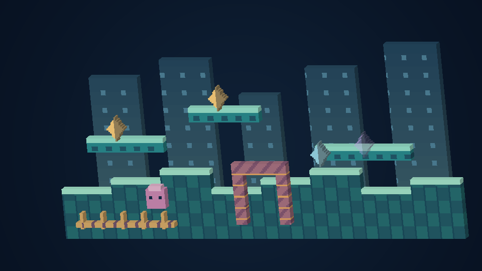

# Píxeles con profundidad

[English](VOXELS.md) · [Français](VOXELS.fr.md) · [日本語](VOXELS.ja.md)

Abre **Vídeo → Profundidad y vóxeles → Volumen de píxeles**. En Quest, la página **Relieve** del mando virtual ofrece botones directos. Las opciones Quest incluyen todos los ajustes. Pulsa el icono de cubo para abrir una explicación ilustrada; el foco del mando y F1/Y también permiten consultar la ayuda.

| Modo | Resultado |
| --- | --- |
| Imagen plana original | Presentación 2D habitual, incluido el píxel 1:1 |
| Píxeles con grosor | La imagen visible adquiere lados y parte trasera sólidos |
| Vóxeles por capas | Terreno y objetos observados se separan según su prioridad |
| Vóxeles esculpidos | Cuatro pequeños escalones de brillo añaden relieve |

Empieza con **Sutil**, **Diorama** o **Intenso**. Después ajusta grosor, separación, luz y límite de detalle. La profundidad usa píxeles del juego original; al redimensionar la escena también cambia su grosor. Luz cero conserva los colores de las texturas. El negro permanece sólido y solo la transparencia crea huecos.

Es una imagen del generador de mallas y un renderizador de referencia independiente. **No es una captura del juego ni una prueba en un dispositivo.** [Comparación plana y esculpida](VOXELS.md).

- **PC, teléfono y tableta:** Frontal recupera la alineación recta; Diorama elige un ángulo suave. Los deslizadores permiten mirar desde un lado o desde arriba sin recortar el volumen. Para píxel 1:1 real, conserva la vista Pixel con renderizado plano.
- **Wear OS:** corona o bisel giratorio para acercar desde el nivel conocido hasta la pantalla original. El fisheye sigue disponible; menús y controles táctiles permanecen planos. El reloj usa menos geometría. Edición experimental.
- **VR/AR:** mueve la cabeza para ver profundidad estéreo real. Los agarres bajo los dedos medios mueven la escena; los dos agarres cambian su tamaño. Pared, suelo, pantalla flotante, pinball y galería curva comparten el mismo espacio.
- **Sala CRT:** la referencia nativa permanece plana por defecto, rodeada por el nivel con volumen. Activa **Píxeles en volumen dentro del CRT** para sustituirla también, con el nivel circundante activado.
- **AR transparente:** se omiten las capas de fondo identificadas para dejar visible la habitación. El fondo opcional es decorativo. El relieve de la pantalla nativa conserva la imagen original completa, incluido su fondo.

Es **reconstrucción procedural de píxeles**, no una colección de nuevos modelos de personajes. Los mapas compatibles conservan coordenadas y prioridades; otras escenas usan relieve de la pantalla nativa. No se inventan cuerpos ocultos, decorados no disponibles ni la altura real de edificios de Sonic 3D. La interfaz integrada en una pantalla nativa forma parte de esa imagen; los menús de la aplicación siguen separados. Colisiones, guardados, apariciones y ritmo original se conservan.

En el ordenador, **Exportar escena 3D localmente** guarda la malla OBJ, su material y textura transparente en una carpeta `UserData/exports` nueva. Mantén los archivos juntos para abrir el modelo. Se conservan las exportaciones previas; este botón nunca sube el arte del cartucho.

La calidad automática ajusta la rejilla completa según la carga; una vista general enorme usa celdas mayores. No descarta los últimos objetos para respetar el presupuesto. Se eliminan caras interiores, se fusionan superficies compatibles y se reutiliza la malla mientras la forma no cambie. Quest mantiene 90 Hz por defecto y las pantallas normales apuntan a 60 imágenes/s; no se garantiza la cadencia real en un dispositivo.

El volumen necesita renderizado OpenGL por hardware compatible. Si no está disponible, la imagen plana sigue funcionando y las opciones muestran un mensaje. **macOS y Wear OS son experimentales. No se ha ejecutado ningún juego, aplicación, emulador o dispositivo para esta versión.** La compilación y las comprobaciones automáticas no certifican arranque, temperatura, controles físicos o fluidez real.
