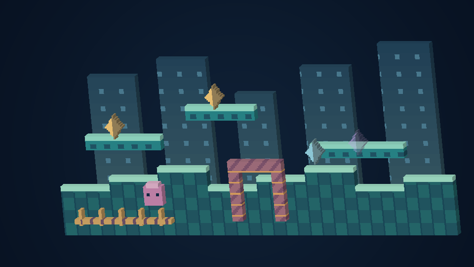

# Des pixels avec de l’épaisseur

[English](VOXELS.md) · [Español](VOXELS.es.md) · [日本語](VOXELS.ja.md)

Ouvre **Vidéo → Profondeur et voxels → Volume des pixels**. Sur Quest, la page **Relief** de la télécommande mobile propose les boutons principaux. Les réglages complets sont aussi dans les options Quest. Clique ou touche l’icône en forme de cube pour lire une explication illustrée ; le focus de la manette et F1/Y donnent aussi accès à l’aide.

| Mode | Résultat |
| --- | --- |
| Image plate originale | Présentation 2D habituelle et réglages de pixels 1:1 |
| Pixels épais | L’image visible gagne des côtés et un dos solides |
| Voxels par couches | Terrain et objets observés sont séparés selon leur priorité |
| Voxels sculptés | Quatre petits paliers de luminosité ajoutent du relief aux surfaces |

Commence avec **Discret**, **Diorama** ou **Prononcé**. **Précision pixel** conserve les pixels du jeu en vue rapprochée dans les limites de l’appareil. La qualité automatique peut simplifier le relief et réduire la taille de l’image séparément. La vue d’ensemble échantillonne la carte pour la faire tenir à l’écran. Ouvre **Affiner le relief et l’angle** pour ajuster le style.

Cette image vient du générateur de maillage et d’un rendu de référence hors application. **Ce n’est ni une capture de jeu ni un essai sur appareil.** [Comparaison avec l’image plate et le relief sculpté](VOXELS.md).

- **PC, téléphone et tablette.** Incline avec le stick droit et clique pour recentrer. **Suivre le joueur** montre une portion détaillée du niveau. Maintiens RB et bouge le stick pour regarder plus loin. **Utiliser la vue choisie** reprend le cadrage habituel, dont **Niveau entier**. Dans Spinball, **Niveau entier** garde la table complète.
- **Montre Wear OS :** couronne ou lunette rotative pour zoomer entre le niveau connu et l’écran original. Le fisheye reste disponible ; menus et commandes tactiles restent plats. La limite de géométrie est plus basse. Version expérimentale.
- **VR/AR :** bouge la tête pour percevoir le relief réel. Les poignées sous les majeurs déplacent la scène et les deux poignées la redimensionnent. Les modes mur, sol, écran flottant, flipper et galerie courbe utilisent le même repère.
- **Pièce CRT :** l’écran de référence reste plat par défaut, entouré d’un niveau en volume. Active **Pixels en volume dans la TV** pour le remplacer aussi, avec le niveau environnant activé.
- **AR transparente :** les couches de fond identifiées sont masquées pour laisser voir la pièce. Le fond optionnel reste décoratif. En mode relief de l’écran natif, l’image d’origine reste entière, avec son fond.

Il s’agit d’une **reconstruction procédurale des pixels**, sans nouveaux modèles de personnages dessinés à la main. Les cartes déjà prises en charge gardent leurs coordonnées et leurs priorités ; les scènes non reconnues utilisent le relief de l’écran natif. Les parties cachées, les décors non disponibles et la hauteur réelle des bâtiments de Sonic 3D ne sont pas inventés. L’interface du jeu intégrée à une image native fait partie de cette image ; les menus de l’application restent séparés. Les collisions, sauvegardes, apparitions et la cadence d’origine sont conservées.

Sur ordinateur, **Exporter la scène 3D localement** enregistre le maillage OBJ, son matériau et sa texture transparente dans un nouveau dossier `UserData/exports`. Garde les fichiers ensemble pour ouvrir le modèle. Les exports précédents sont conservés ; ce bouton n’envoie jamais les images issues de cartouches.

La qualité automatique ajuste la grille entière selon la charge ; une grande vue d’ensemble utilise des cellules plus grosses. Elle ne supprime pas les derniers objets pour respecter le budget. Les faces intérieures sont retirées, les surfaces compatibles fusionnées et le maillage est réutilisé tant que la forme reste identique. Le Quest garde 90 Hz par défaut ; les écrans ordinaires ciblent 60 images/s, sans garantie de cadence réelle sur appareil.

Le rendu en volume nécessite un moteur matériel OpenGL compatible. En cas d’indisponibilité, l’image plate reste accessible et un message l’indique dans les réglages. **macOS et Wear OS sont expérimentaux. Aucun jeu, application, émulateur ou appareil n’a été lancé pour cette version.** Les compilations et vérifications automatisées ne valident pas le démarrage, la chaleur, les commandes physiques ou la fluidité réelle.
