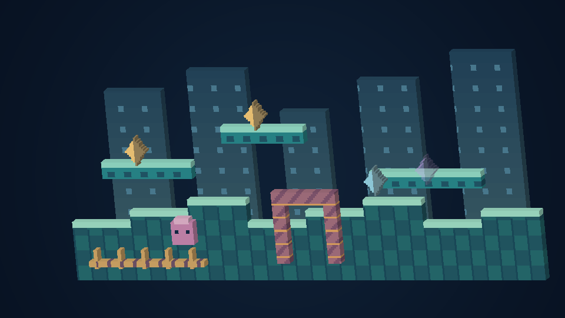

# ピクセルの立体表示

[English](VOXELS.md) · [Français](VOXELS.fr.md) · [Español](VOXELS.es.md)

**映像 → 立体感とボクセル → ピクセルの立体表示**を開きます。Questでは、動かせるリモコンの**立体**ページから主な項目を直接操作できます。Questの設定にも全項目があります。立方体のアイコンを押すと図解が開き、ゲームパッドの選択やF1/Yでも説明を確認できます。

| モード | 見た目 |
| --- | --- |
| 元の平面画像 | 通常の2D表示と1:1ピクセル表示 |
| 厚みのあるピクセル | 元の絵に側面と裏面を加える |
| レイヤー別ボクセル | 観測した地形と物体を描画順に分ける |
| 段差のあるボクセル | 明るさから四段階の小さな凹凸を加える |

まず**控えめ・ジオラマ・強調**を選び、厚み、間隔、照明、詳細度の上限を調整してください。厚みの単位は元のゲームのピクセルです。場面のサイズを変えると厚みも同じ比率で変わります。照明をゼロにすると元のテクスチャの色を保ちます。黒いピクセルも残し、透明な部分だけを穴にします。

この画像はオリジナルの図柄とメッシュ生成器を使った、アプリとは別の参照描画です。**ゲーム画面や実機のキャプチャーではありません。** [平面・段差表示との比較](VOXELS.md)。

- **PC・スマートフォン・タブレット:** 正面ボタンはまっすぐな配置に戻し、斜め表示は緩やかな角度を選びます。左右・上下の角度を変えても全体が収まります。厳密な1:1表示には平面のピクセル表示を使ってください。
- **Wear OS:** クラウンや回転ベゼルで、対応するステージ全体から元の画面までズームできます。魚眼表示も利用でき、メニューとタッチ操作は平面のままです。時計では形の詳細度を抑えます。実験版です。
- **VR/AR:** 頭を動かすと本当の両眼視差が見えます。中指のグリップで場面を動かし、両方のグリップで拡大縮小します。壁、床、浮遊画面、ピンボール台、曲面ギャラリーで共通の座標を使います。
- **ブラウン管モード:** 元の基準画面は既定では平面で、周囲のステージが立体になります。周囲のステージを表示したうえで**ブラウン管の中も立体にする**を有効にすると、テレビ内も置き換えられます。
- **透明なAR:** 部屋が見えるよう、識別できた背景レイヤーを省きます。追加できる背景は装飾用です。元の画面に厚みを付ける場合は、背景を含む画面全体を使います。

これは**ピクセルから生成する立体**で、新作のキャラクターモデル集ではありません。対応する拡張マップは観測した座標と優先度を保ち、その他の場面は元の画面に厚みを付けます。隠れた身体、未取得の景色、Sonic 3Dの建物の本当の高さは推測しません。元の画面に描かれたゲーム内UIもその絵の一部です。アプリのメニューは別に保ちます。当たり判定、セーブ、出現条件、ゲーム速度は変えません。

パソコンでは、**3Dシーンを端末内に書き出す**を選ぶと、OBJの形状、マテリアル、透明なテクスチャを新しい `UserData/exports` フォルダーに保存できます。ファイルを同じ場所に置いてモデルを開いてください。以前の書き出しは残り、カートリッジ由来の画像を自動送信しません。

自動の画質調整は負荷に応じて格子全体の細かさを変え、巨大な全体表示では大きなセルを使います。上限を守るために末尾の物体だけを省くことはありません。内部の面を除き、同じ形の面をまとめ、色だけの変化ではメッシュを再利用します。Questの既定は90 Hz、通常画面の目標は60 fpsですが、実機での維持は保証していません。

立体表示には対応するOpenGLのハードウェア描画が必要です。利用できなければ平面画像を保ち、設定に説明を表示します。**macOSとWear OSは実験版です。この版ではアプリ・ゲーム・エミュレーター・実機を起動していません。** ビルドや自動検証だけでは起動、発熱、物理操作、実際の滑らかさを認定できません。
