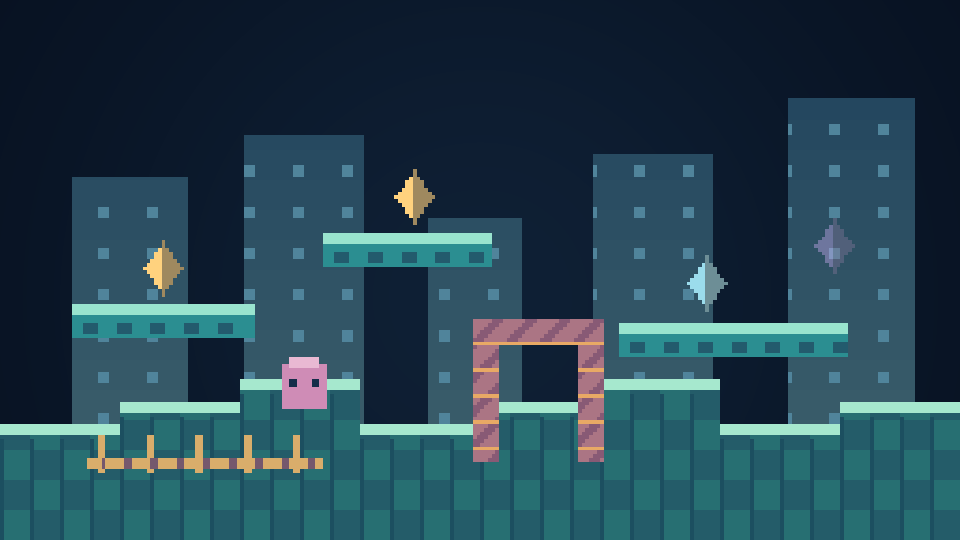
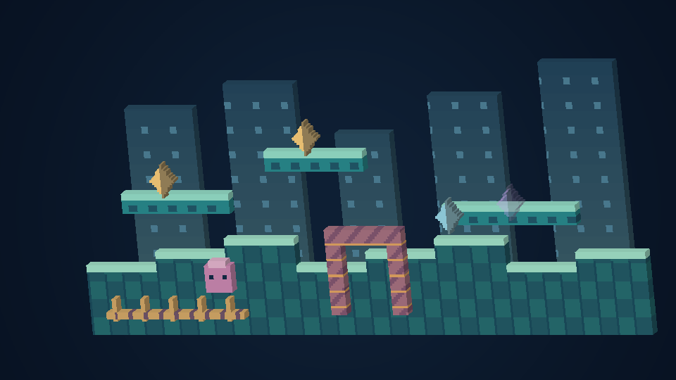
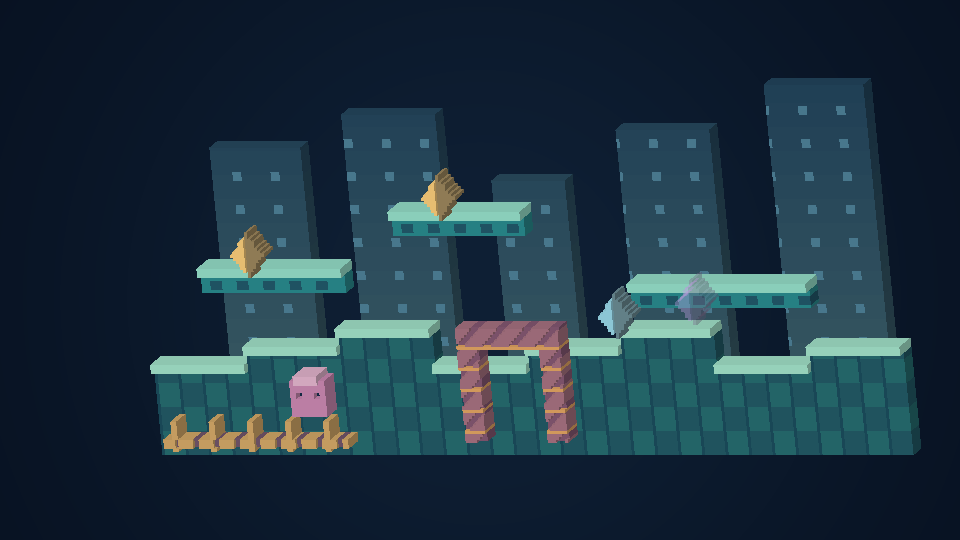

# Pixels with depth

[Français](VOXELS.fr.md) · [Español](VOXELS.es.md) · [日本語](VOXELS.ja.md)

Open **Video → Depth and voxels → Pixel volume**. On Quest, the **Depth** page of the movable remote has direct buttons. The complete settings are also in the Quest options. Click or touch a setting's cube icon for its illustrated explanation; controller focus and F1/Y work too.

| Mode | What changes |
| --- | --- |
| Original flat picture | The existing 2D presentation, including literal-pixel choices |
| Thick pixels | The visible artwork gains solid sides and backs |
| Layered voxels | Observed terrain and actors occupy separate priority planes |
| Sculpted voxels | The same planes gain four small, brightness-based surface steps |

Choose **Subtle**, **Diorama** or **Bold** as a starting point. **Performance**, **Balanced** and **Sharp** change how finely the volume is sampled. Open **Fine-tune depth and angle** to adjust the style. Thickness uses original game-pixel units and scales with the scene.

These three pictures use original fixture art and the actual procedural mesh, rendered by an offline CPU reference helper. **They are not game screenshots or captures from a phone, watch, PC application or headset.** [Provenance](illustrations/voxel-provenance.json).

## Choose a comfortable view

- **PC, phone and tablet.** Use the right stick to tilt and press it to recenter. **Follow player** keeps a detailed stretch of the level in view. Hold the right shoulder and move the stick to look farther around that stretch. **Use selected view** keeps the regular framing, including **Whole level**. On Spinball, **Whole level** keeps the full table.
- **Wear OS:** the crown or rotating bezel still changes the known-stage/native-screen zoom. Menus and touch controls stay flat, and the optional round lens applies to the game picture. Watches use a smaller geometry ceiling. The watch edition remains experimental.
- **VR/AR:** head movement reveals real stereo depth. Use the middle-finger grips to place the complete scene, and two grips to resize it. Wall, floor, floating screen, cabinet and curved-gallery presentations use the same pixel-to-space mapping. Curved panels subdivide long faces and limit extreme depth to avoid folding the arc.
- **CRT room:** the surrounding level gains volume while the native CRT reference remains flat by default. Enable **Voxel pixels inside the CRT** to replace that reference too. The surrounding-level option must be enabled.
- **Transparent AR:** identified background planes are omitted so the room stays visible. The optional background layer is decorative: supported platformer layouts use background tiles; other expanded scenes repeat the observed backdrop. Native-screen relief retains the complete original image, including its background.

## What is reconstructed

For an extended stage already supported by the map decoder, terrain retains its original world coordinates. The console's observed priority places low actors behind high foreground and high actors in front. Original actor pieces, rings and transparent spawn previews can have volume without changing spawning, collisions, rewind, saves or simulation speed. Terrain is retained underneath actors so a changed viewing angle can reveal it.

**This is automatic pixel-volume reconstruction, not a collection of newly authored 3D character models.** It does not invent hidden bodies, complete unavailable streamed artwork or infer the true height of Sonic 3D buildings. Scenes without a supported extended map use native-screen relief; their original screen artwork, including embedded game UI, remains the source. The options identify which source is active. Application menus and the independent native reference remain separate.

## Keep a local 3D copy on desktop

**Export 3D scene locally** saves the current OBJ mesh, material and transparent TGA texture in a new `UserData/exports` folder. Keep the files together when opening the model. Existing exports are preserved. Cartridge-derived artwork stays private and is never uploaded by that button.

## Quality and performance

The detail ceiling limits geometry sampling. Automatic quality can lower the entire grid under load, then restore it as the existing governor finds spare time. Fine original-pixel detail is possible where the selected source and budget permit it; a very large overview uses coarser cells. No objects at the end of the scene are deliberately dropped to meet the face limit.

The renderer removes internal faces, merges compatible surfaces and caches geometry by shape and priority. Palette changes only update the texture when the shape is unchanged. CPU scene sampling, voxel detail, effects and stereo resolution participate in the existing performance limits; Quest retains its **90 Hz default** and ordinary displays their **60 fps target**. Actual sustained FPS is not certified.

The PC/mobile volume picture uses depth-tested OpenGL 2.x or OpenGL ES 2.x hardware rendering. The desktop frontend prefers a compatible OpenGL backend and retains accelerated/software flat fallbacks. If volume rendering is unavailable, the original flat image remains usable and the options show a message. macOS and Wear OS remain experimental.

No app, game, emulator, installer or physical device was executed for 0.11. Generated geometry, compositor equivalence, language/font checks, offline shader compilation, platform builds, Android lint and static package audits are separate from startup, thermal, visual and control qualification.

[Rendering design and comparison survey](VOXEL_RESEARCH.md) · [Automatic quality](AUTOMATIC_QUALITY.md) · [Watch controls](WEAR.md)
