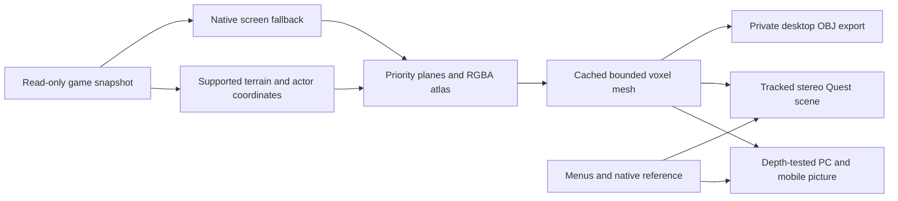

# Volume rendering: comparison and design

Reviewed on **2026-11-06**. This is a focused survey of relevant emulation, source-port, voxel and VR work, rather than a claim to inspect every private codebase. Public implementations were read upstream; closed projects were considered through their own documentation. No competitor executable, ROM, game asset, private profile or model was downloaded.

## Material actually examined

| Source | Read material | Design decision |
| --- | --- | --- |
| [Sonic 3 A.I.R.](https://github.com/Eukaryot/sonic3air/tree/b0063dfb4b3e69d710e131ab83507cdf8c41910f) | Oxygen `OpenGLRenderer.cpp`, `DisplayMenu.cpp`, GPLv3 text | Preserve explicit priority queues, retain image resources and explain renderer fallbacks. No Oxygen code is imported. |
| [RSDKv4 decompilation](https://github.com/RSDKModding/RSDKv4-Decompilation/tree/af95198f93951cc217b43923196e5750667ec1c7) | `RSDKv4/Renderer.cpp` and project licence | Batch coherent state and make depth/blending explicit. Its specific licence was read; no RSDK renderer code or assets are incorporated. |
| [3dSNES](https://github.com/sp00nznet/3dsnes/tree/078b8533735071058c306b5f2989b43aca707347) | `voxelizer.c`, `soft_renderer.c`, README, MIT/third-party notices | Columns, layer ordering and bounded geometry are relevant. SCU retains opaque black, uses observed priority for layers and renders with GPU depth testing. CPU rendering is confined to an offline fixture tool. |
| [Zaxnes](https://github.com/nixxou/zaxnes/tree/4d09c89b8de963daa72026a8f7760775ba2224e3) | `geometry/tile_mesh.rs`, `gl/mesh_cache.rs`, GPLv3 metadata | Separate shape from colour, retain GPU geometry and verify outward normals. SCU has its own occupancy/priority cache and texture atlas; no Rust code, profiles or game data are copied. |
| [3dSen / Geod Studio](https://geodstudio.net/) | Official explanation of dioramas, profiles, free camera and scene export | Adjustable depth, original timing and local export are useful directions. Its hand-tuned profiles were not available source for this work. SCU does not claim their coverage or invent hidden character models. |
| [EmuVR](https://www.emuvr.net/wiki/Main_Page) | Official CRT-room and interaction overview | Keep the native reference readable and independently placeable. SCU retains its own furniture/grip system and adds a choice to voxelize the CRT image. No room or television assets are borrowed. |
| [CRT Lottes Fast](https://github.com/libretro/slang-shaders/blob/master/crt/shaders/crt-lottes-fast.slang) | Shader source, performance notes, Unlicense notice | Keep display effects optional and separate from source artwork. The existing Efficient/Reference CRT remains distinct from the new one-sample volume shader. No Slang code is imported. |
| [Meshing in a Minecraft Game](https://0fps.net/2012/06/30/meshing-in-a-minecraft-game/) | Mikola Lysenko's original discussion of hidden faces, greedy merging and update latency | Remove internal faces and merge compatible boundaries while bounding rebuild work. SCU independently implements these techniques and retains colour variation in a texture. |
| [SDL 2.32.10 renderer source](https://github.com/libsdl-org/SDL/tree/release-2.32.10/src/render) | Pinned local `SDL_render_gl.c` and `SDL_render_gles2.c` | Respect target orientation, channel conversion and texture-state bookkeeping. The volume output uses RGBA32 and restores GL after SDL's Bind/Unbind cache updates. |

The first four revisions were verified against upstream commit metadata. These are design references, not new vendored dependencies. Existing licences remain in [THIRD_PARTY_NOTICES.md](../THIRD_PARTY_NOTICES.md). The new mesher, shader, exporter and fixture art are original project code.

## Coordinates before artistic depth

Supported decoders provide the same world coordinates as the panorama. Terrain remains underneath actors. Observed priority orders low background, low terrain, low actors, high background, high terrain and high actors; spawn hints have a separate transparent plane. Every band reserves its complete thickness and sculpted relief before the next band begins, even at zero air spacing.

Sculpting adds four small brightness steps **within** a band. It never decides whether black is empty or infers a building's true height. Unprofiled scenes use native-screen relief. The app identifies that fallback rather than assigning invented object coordinates or promising unseen artwork.

## Runtime budget

The detail ceiling is a maximum sampling budget. It does not promise one original pixel per cell across an enormous map. Dyadic grids avoid rebuilding for tiny budget changes. Watches and Android have lower limits; adaptive effect quality can reduce the ceiling under load. An over-budget scene is retried completely at a coarser grid instead of truncating the object list.

Compatible front/back rectangles merge while colour remains in a texture. Side intervals remove equal-height internal boundaries. Terrain and actor planes have separate shape and colour signatures, so palette animation can reuse vertex buffers whenever it does not change sculpted height or occupancy. With row-stride support, only changed atlas planes upload. GLES 2 can upload a complete atlas when pixels change; an unchanged picture uploads nothing. The two-column/four-row atlas fits within 2048×2048 pixels.

PC/mobile loads GL/ES functions from SDL's context, uses a depth-tested offscreen picture and preserves a localized flat fallback. Quest consumes the mesh directly in both eyes, retains stable eye swapchains/foveation and updates scene geometry independently of tracking. Curved panels subdivide wide faces before bending and proportionally limit extreme relief to prevent folds.

The volume shader has one texture lookup and small directional/ambient lighting. It adds no ray tracing or synchronous GPU readback. Thick/layered/sculpted styles share one program. Desktop OBJ/TGA export runs only when selected in paused options and never uploads derived artwork.

## Evidence

Generated checks cover holes, opaque black, alpha shells, winding, priority separation, palette cache reuse, face-limit recovery, platform budgets and camera fitting. The panel conversion used by Quest is checked on flat/curved surfaces. Cached/fresh compositor checks compare volume pixels and geometry. Export checks use generated pixels and reject existing destinations.

The comparison pictures use original fixture pixels and the actual mesh with an offline CPU reference renderer. They are **not** game, app or device captures. Builds, lint, static APK audits and offline shader linking remain separate from startup, actual GPU output, thermals, controls and sustained FPS. No app, game or device session was executed for 0.11; macOS and Wear OS remain experimental.
