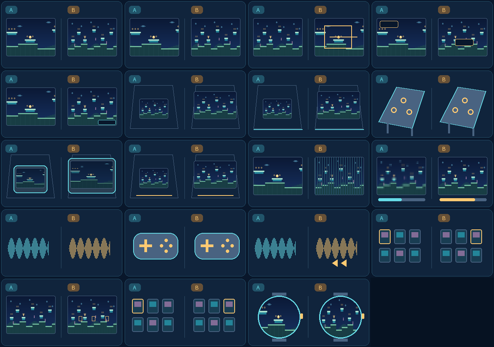

# Wear OS preview

**A separate standalone watch APK**, with a round-screen layout, crown/bezel zoom and an optional fisheye. It does not require the phone app. The build targets Android 8.0 / API 26 or newer, OpenGL ES 2.0 and ARM64, ARMv7 or x86-64. Compatible Android rotary input is detected automatically; no model-name whitelist is used.

This is an **experimental development preview**. Version 0.12.3 adds larger colored game rows, a palm backdrop and a single navigation row. It also enables the core's byte-safe scanline path on ARMv7, fixing the game-start alignment crash reproduced on a Galaxy Watch8 Classic. Physical checks and their limits are recorded in the release notes; other watch models and sustained battery life remain unqualified.

## Get ready

1. Download **Android-Wear-ROM-free.apk**, then sideload it using your usual Wear OS ADB or companion sideload tool. The phone/tablet and Quest APKs are separate downloads.
2. Open the library and choose your own supported cartridge. Public packages contain no ROMs. If the watch has no system document picker, copy your own cartridge files into the app's ROM inbox below, then tap **Choose ROM…**. The app copies supported files into private storage and imports them; return to the library when ready. Originals and existing private copies are kept.
3. Tap a colored game row to play. The **Menu** button or Android **Back** opens options. Swipe vertically or rotate the crown to scroll. Tap the section name beside **Back** to choose another page or switch between Simple and Advanced.

Local USB/Wi-Fi ADB inbox, after installing the app:

```sh
adb shell mkdir -p /sdcard/Android/data/com.vhaloo.soniccompilationultra.wear/files/ROMs
adb push YOUR_OWN_CARTRIDGE.zip /sdcard/Android/data/com.vhaloo.soniccompilationultra.wear/files/ROMs/
```

Only local cartridge files up to 32 MB are accepted. The app neither downloads ROMs nor requests network/storage-wide permissions. See the [cartridge guide](ROMS.md).

## Zoom without losing the level

- Rotate the crown or compatible rotating bezel while playing. **0%** fits the complete known stage; **100%** reaches the original console viewport and follows its camera. The transition is continuous.
- **Watch / crown** contains sensitivity, reverse direction, the two endpoint buttons, fisheye and lens strength. **Reduce motion** makes zoom changes immediate.
- The optional lens keeps the source edges inside the round display and emphasizes the center. Touch targets and menus remain flat. Disable it for a conventional aspect-correct rectangle.
- Tap **…** to switch between the movement/A/B/C/Start controls and the map/zoom/rewind controls. Direction and face buttons accept simultaneous fingers. A connected gamepad can hide the touch controls; Menu remains reachable.
- On a square watch the game keeps a flat, aspect-correct picture. Scenes without a supported map decoder retain their native view. “Whole stage” means the currently supported map, not undiscovered scripted content.

The new installation targets 60 fps with automatic scene sampling, effects and a 30% work reserve. It uses a small scene ceiling, a retained lens mesh and a 24 MB rewind profile. The system and native simulation still set practical limits. [Performance choices](AUTOMATIC_QUALITY.md) explain the tradeoffs.

**Video → Depth and voxels** adds optional pixel volumes, including with the crown and round lens. Watch geometry and texture limits are smaller. For the lowest drawing cost, keep the default Flat mode. [Depth guide](VOXELS.md).



The menu uses the same English/French/Spanish/Japanese setting explanations as desktop and XR. Tap a setting's icon for the illustrated guide. The examples are original demo art, not cartridge or device screenshots.

Keep save states on the device architecture that created them. The native emulator's older save format is not portable between a 64-bit PC and an ARMv7 watch. Cartridge files can be imported independently.

Platform references: [Android rotary input](https://developer.android.com/training/wearables/compose/rotary-input), [standalone Wear OS manifest and storage](https://developer.android.com/training/wearables/apps/standalone-apps). The lens follows the round-display design used in the owner's OrbitEmu project; its C++ implementation and controls are independent.
