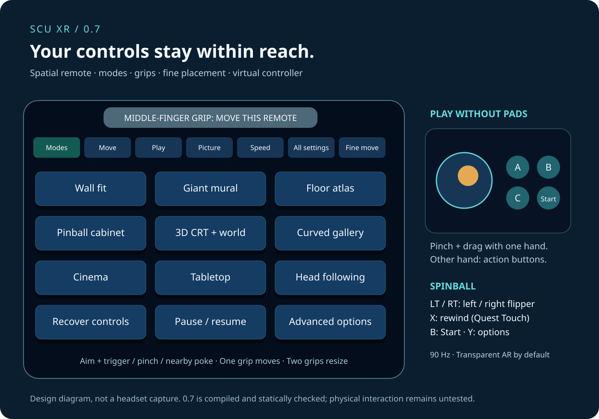

# Quick XR controls — 0.7

**This release has not been tried on a headset.** The following describes the implemented controls to check later.

- **Y** opens the complete options panel. The floating remote's **All settings** page reaches every section; held scroll buttons work with hands too.
- **Aim + trigger**, **hand ray + pinch**, or **poke a nearby button** to press a spatial button. A cyan button is hovered; a depressed amber button is pressed; `[+]` indicates an active choice.
- **Move** chooses stage, native CRT, remote or options. Hold **one middle-finger grip** to move/rotate the target. Aiming at the remote's top handle or native CRT's bottom handle selects that object directly. Choosing the stage unlocks it.
- **Two grips** resize the stage, including while placement is locked. Release/regrip to keep going; right-stick up/down also scales while both grips are held. Half/double/reset buttons are on Move.
- **Fine move** provides held left/right/up/down/near/far and yaw/pitch buttons for the selected target.
- **R3** brings controls and the native CRT near you. The recover button also recentres the stage when it is the selected target.

The native close-up is an independently movable CRT in expanded modes. Its physical width, TV style and shader are configurable. In the main CRT mode, moving the native CRT moves the television and matched stage together. The options panel has its own size setting, independent of its distance. Session poses reset when the app restarts; sizes are saved.

## Without controllers

Enable hand tracking in the Quest system. If neither Touch tracking nor an external pad is detected, the large virtual controller appears automatically. Pinch/drag the big stick with one hand; use the other for A/B/C, Start, both flippers or rewind. Poke works when the panel is within reach. Middle-finger pinch grabs handles. Losing tracking or focus releases the controls. Auto/always/off and hand input are selectable in advanced XR options.

## Spinball

| Input | Default action |
|---|---|
| LT / RT | Native A / B: left / right flipper |
| Both triggers | Both flippers |
| Quest Touch X | Rewind with reverse sound |
| Ordinary gamepad LB | Rewind with reverse sound |
| Quest Touch B / ordinary pad Start | Original Start |
| Quest Touch Y / ordinary pad Select | Options |
| Keyboard Z / X / C | Native A / B / C |
| Keyboard Enter / Backspace / Esc | Start / rewind / options |

The cartridge's own alternate control-mode setting can change which native button does what. Disable the trigger layout to return to the ordinary collection bindings. Small border reminders and the virtual-controller labels describe controls without covering the playfield.

## Defaults

90 Hz preference, transparent scenery in AR, automatic Spinball cabinet, visible spatial remote, automatic hand-controller fallback and a movable native CRT in expanded views. Existing pre-0.7 XR preferences receive a one-time 90 Hz/transparent/coplanar migration with a settings backup; later choices persist. **Picture → Transparent AR background** restores the selected background style when disabled. The native CRT and pinball board keep their original image.
